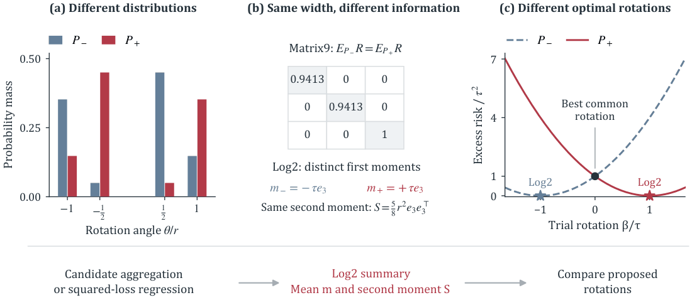
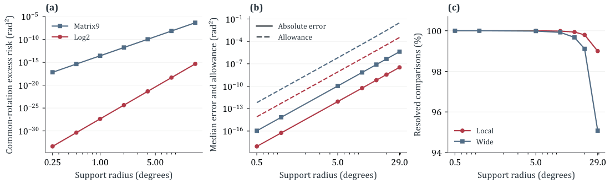

# Log2: compact rotation summaries for 6D pose refinement

**Compact Local Rotation Summaries for Fast Risk Evaluation in 6D Pose Refinement**  
Pihong Hou · Yongfang Zhang · Boxuan Ye

A pose estimator can retain hundreds of plausible rotations for one object. Log2 summarizes their weighted distribution in **36 bytes** using three values for the mean of local rotation vectors and six values for the symmetric second moment. A downstream module can compare proposed rotations in constant time and use an analytic interval to decide when the score's sign is reliable.



## Results at a glance

| Setting | Result |
| --- | --- |
| Message size | 36 bytes for Log2. Weights alone use 2,048 bytes for a shared bank of 512 rotations. |
| Risk-difference RMSE at equal width | 65.2× lower for WAPR and 62.5× lower for FoundationPose, relative to the tested Matrix9 decoder. |
| ICP rotation pairs | Log2 reversed 1 of 65,979 FullPool orderings. The analytic interval resolved 99.42% of the pairs without an incorrect resolved sign. |
| Benchmarks | LM-O, IC-BIN, TUD-L, T-LESS and YCB-V, with about 200,000 valid candidate banks per estimator. |



These results measure fidelity to the candidate bank. The bank can itself disagree with ground-truth orderings, so the paper measures risk fidelity and final pose quality separately.

## Quick start

The example and aggregate replay run on CPU. Use Python 3.9–3.12.

```sh
git clone https://github.com/houph4/log2-rotation-risk.git
cd log2-rotation-risk
python -m pip install -r requirements.txt
python examples/compare_rotations.py
```

The example prints the 36-byte message length, the approximate risk difference, its analytic interval, the exact FullPool score, and the resulting decision.

## Compare your own proposals

1. Transform candidates and queries to relative axis-angle vectors around the same reference rotation. Express angles in **radians**.
2. Normalize the nonnegative candidate weights to sum to one and call `encode_moments(rotations, weights)` in [the geometry module](numerical_release/geometry.py).
3. Decode once with `decode_moments(message)`. For each pair, evaluate `polynomial(proposed, current, mean, second_moment)` and its half-width `allowance(proposed, current, r, message)`.
4. A wholly negative interval favors the proposed rotation, a wholly positive interval favors the current one, and an interval containing zero is unresolved.

For the bound, use a support radius `r < π/6` containing all candidate vectors and query norms at most `2r`. Symmetry-aware comparisons also require the local symmetry condition in the paper.

## Reproduce the included checks

| Command | Output |
| --- | --- |
| `python numerical_release/test_encoders_and_wire.py` | Encoder, wire-layout and float32 rounding checks. |
| `python numerical_release/replay_full_dense_tables.py --check-only` | Validates risk-fidelity and boundary-sign statistics from the included CSVs. |
| `python numerical_release/replay_full_dense_tables.py` | Writes the reconstructed aggregate tables to `numerical_release/results/full_dense/`. |
| `python figure_data/plot_decision_rates_and_bounds.py` | Rebuilds the figure above from its source CSVs. |

## Experiment code and data

- [Geometry and encoding](numerical_release/geometry.py) provides Log2, Matrix9, Indexed-6 and FullPool.
- [Experiment scripts](numerical_release/) include ICP-pair analysis, shared-bank comparisons, acceptance-budget analysis and learned heads. These runs require the associated local candidate banks, pose-pair records or rendered features. See `requirements-experiments.txt` for extra dependencies.
- The aggregate replay uses the included CSV statistics. Raw RGB-D images, CAD assets, pretrained weights and large per-target records are separate. Obtain benchmark data from [BOP](https://bop.felk.cvut.cz/datasets/).
